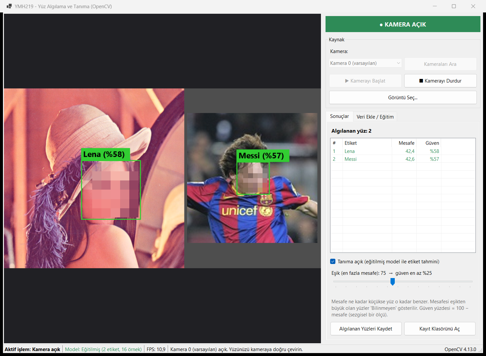
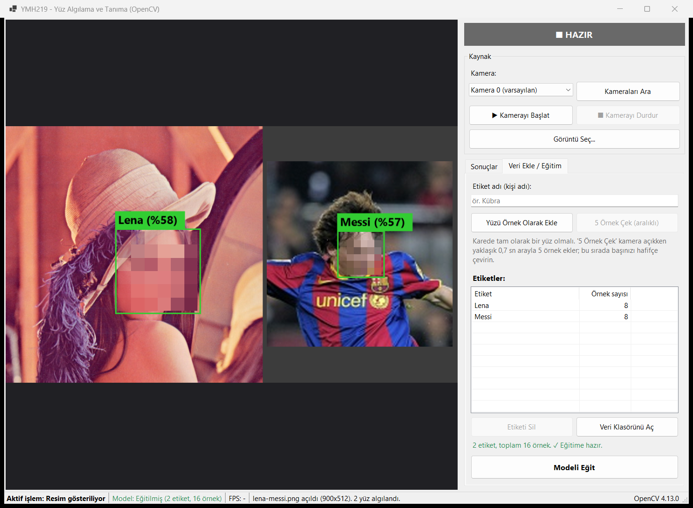
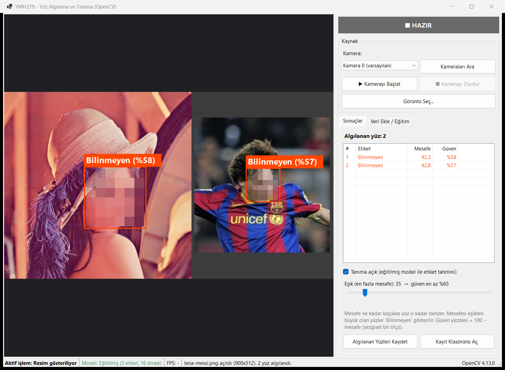
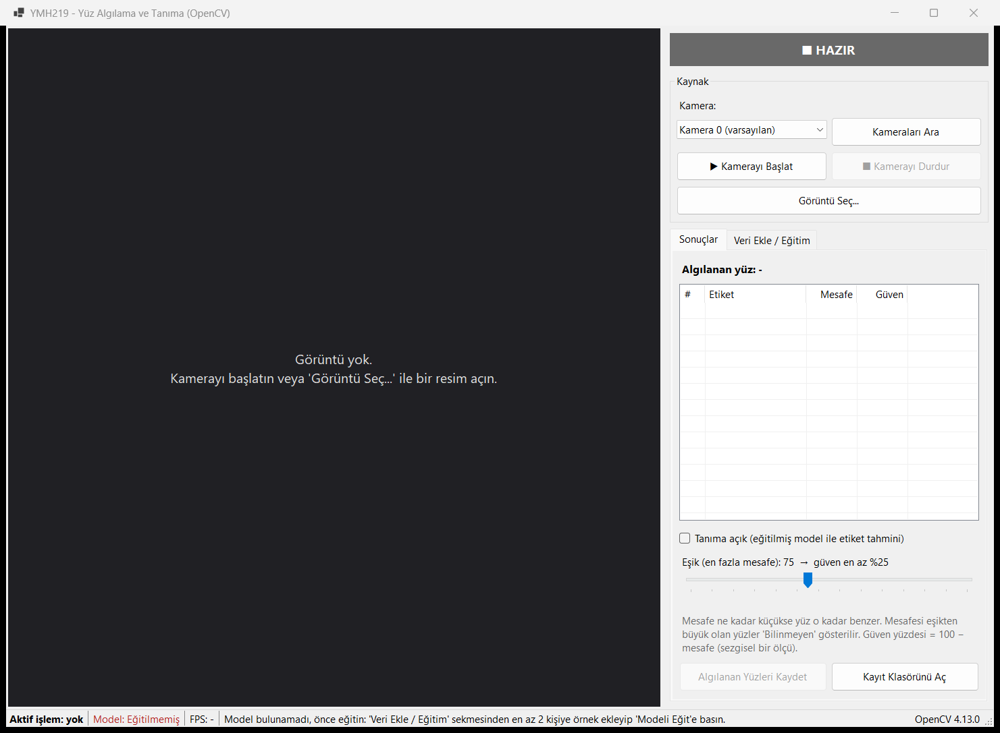

# YMH219 - Yüz Algılama ve Tanıma

Nesne Tabanlı Programlama (YMH 219) dersi için C# / Windows Forms ve OpenCV (OpenCvSharp) ile yazılmış yüz algılama ve temel yüz tanıma uygulaması. Kameradan veya dosyadan alınan görüntüde yüzler bulunur; küçük bir yerel örnek kümesiyle LBPH kullanılarak etiketleme yapılır.

## Özellikler

- Kamerayı başlatma / durdurma ve kamera seçimi
- Dosyadan görüntü açma (jpg, png, bmp)
- Haar cascade ile birden fazla yüz algılama
- LBPH ile yüz tanıma (eşik ayarı, güven skoru)
- Etiket ekleme, örnek toplama, model eğitme
- Algılanan yüzleri klasöre kaydetme

## Kullanılan teknolojiler

- C# / .NET 9, Windows Forms (x64)
- OpenCvSharp4 4.13.0.20261107
- OpenCvSharp4.runtime.win 4.13.0.20261107
- `haarcascade_frontalface_default.xml`

## Çalıştırma

```powershell
git clone https://github.com/kubradmrgc/YMH219-FaceRecognition.git
cd YMH219-FaceRecognition
dotnet run --project FaceRecognition
```

Kamera açılmazsa Windows Ayarlar > Gizlilik ve güvenlik > Kamera izinlerini kontrol edin.

### Kısa kullanım

1. Kamerayı başlatın veya bir görüntü seçin.
2. En az 2 etiket için örnek ekleyin (etiket başına en az 5 örnek önerilir).
3. Modeli eğitin, tanımayı açın.

Örnekler ve model `%LOCALAPPDATA%\YMH219-FaceRecognition` altında tutulur; depoya eklenmez.

## Ekran görüntüleri










## Sınırlamalar

- Önden bakan yüzlerde daha iyi çalışır; yandan / kötü ışıkta zayıflar.
- Küçük veri setinde LBPH doğruluğu sınırlıdır.
- Yalnızca x64 Windows.

## Öğrenci

- Ad Soyad: Kübra Demirgüç
- Öğrenci No: 230541115
