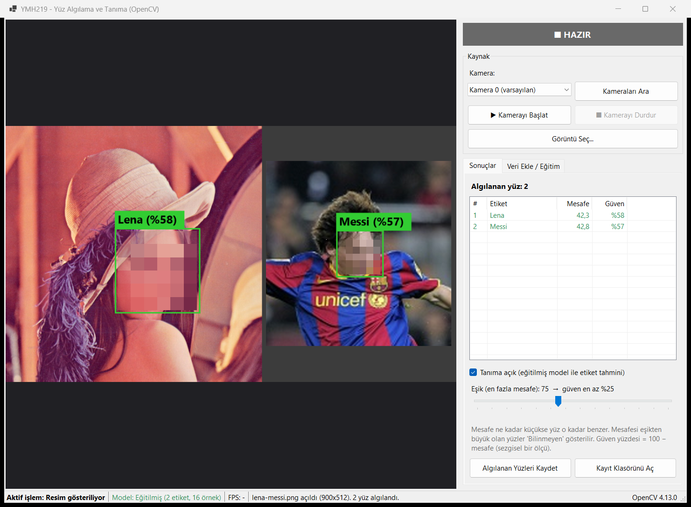

# YMH219-FaceRecognition

OpenCV (OpenCvSharp) ile kameradan veya dosyadan alınan görüntüde yüzleri algılayan ve öğrencinin oluşturduğu küçük,
yerel bir örnek kümesiyle temel yüz tanıma (etiketleme) yapan C# Windows Forms uygulaması.

> **Ders:** Nesne Tabanlı Programlama (YMH 219) · **Öğrenci:** Kübra Demirgüç (230541115)



## Özellikler

- **Görüntü kaynağı**
  - Kamera seçimi (0–3 numaralı kameralar denenerek bulunur), **Kamerayı Başlat** / **Kamerayı Durdur**.
  - **Görüntü Seç...** ile `.jpg`, `.jpeg`, `.png`, `.bmp` dosyası açma. 1920 pikselden büyük resimler işlem için küçültülür.
  - Türkçe ve Unicode karakterli klasör yollarında sorunsuz okuma/yazma.
- **Yüz algılama**
  - Haar cascade ile aynı karede birden fazla yüz bulunur ve dikdörtgenle işaretlenir.
  - Canlı kamera akışında algılama arka planda yapılır; FPS durum çubuğunda gösterilir.
- **Yüz tanıma**
  - LBPH tanıyıcısı. Her yüz için etiket, ham mesafe ve güven yüzdesi hem resmin üstünde hem sonuç listesinde gösterilir.
  - Tanınan yüzler **yeşil**, eşiği aşan yüzler **turuncu-kırmızı** ve "Bilinmeyen" olarak çizilir.
  - Ayarlanabilir eşik (varsayılan 75) ve "Tanıma açık" onay kutusu.
  - Model eğitimden sonra diske kaydedilir ve uygulama açılırken otomatik yüklenir.
- **Veri ekleme ve eğitim**
  - Kameradan ya da seçilen resimden tek yüzü örnek olarak ekleme. **5 Örnek Çek** düğmesi kamera açıkken yaklaşık 0,7 sn arayla 5 örnek toplar.
  - Etiket listesi (ad + örnek sayısı), onay sorulu **Etiketi Sil**, **Veri Klasörünü Aç**.
  - Yeterlilik bilgisi: en az 2 etiket gerekir, etiket başına en az 5 örnek önerilir.
  - **Modeli Eğit** arka planda çalışır; arayüz donmaz, gösterge "EĞİTİLİYOR" olur.
  - Veri seti modelden sonra değiştiyse durum çubuğu "veri değişti, yeniden eğitin" uyarısı verir.
- **Yüz kaydetme:** **Algılanan Yüzleri Kaydet** ekrandaki her yüzü `yuz-yyyyMMdd-HHmmss-fff-N-etiket.png` adıyla kaydeder; **Kayıt Klasörünü Aç** klasörü gösterir.
- **Kullanıcı geri bildirimi**
  - Renkli durum göstergesi: HAZIR (gri), KAMERA AÇIK (yeşil), EĞİTİLİYOR (turuncu).
  - Durum çubuğu: aktif işlem, model durumu, FPS ve son mesaj.
- **Hata bildirimleri:** uygulama çökmez, Türkçe ve anlaşılır bir mesaj gösterir.
  - Kamera bulunamadı, başka uygulama tarafından kullanılıyor, görüntü gelmiyor (Windows kamera izni ipucuyla) ya da bağlantı kesildi.
  - Resim bozuk, boş, desteklenmeyen biçimde veya çok büyük.
  - Haar cascade dosyası yok veya bozuk: uygulama açılır, yalnızca algılama devre dışı kalır.
  - Model yok ("Model bulunamadı, önce eğitin"), model bozuk, `labels.json` eksik/bozuk ya da modelle uyumsuz.
  - 2'den az etiketle eğitim istenmesi.
  - Geçersiz etiket adı.

## Kullanılan teknolojiler

| Bileşen | Sürüm |
|---|---|
| .NET SDK / hedef çatı | .NET 9 (`net9.0-windows`), Windows Forms, x64 |
| [OpenCvSharp4](https://www.nuget.org/packages/OpenCvSharp4) | 4.13.0.20261107 |
| [OpenCvSharp4.runtime.win](https://www.nuget.org/packages/OpenCvSharp4.runtime.win) | 4.13.0.20261107 (OpenCV 4.13.0 yerel kütüphanesi) |
| Haar cascade | `haarcascade_frontalface_default.xml` ([OpenCV deposu](https://github.com/opencv/opencv/tree/4.x/data/haarcascades)) |

`OpenCvSharp4.Windows` ve `OpenCvSharp4.Extensions` paketleri kullanılmadı. Bu paketler `System.Drawing.Common` 10 sürümünü
getiriyor ve .NET 9 Windows Forms uygulaması açılırken `TypeLoadException` ile çöküyordu. Bu yüzden OpenCvSharp4 ile Windows
çalışma zamanı paketi ayrı ayrı eklendi. `Mat` → `Bitmap` dönüşümü de projedeki `MatBitmapConverter` sınıfıyla yapılıyor.

### Haar cascade nasıl çalışır?

Haar cascade, yüzün aydınlık-karanlık bölge desenlerini (göz bölgesi yanaktan koyu, burun köprüsü gözlerden açık gibi)
basit dikdörtgen özelliklerle arar. Resim farklı ölçeklerde taranır. Her pencere art arda dizilmiş (cascade) sınıflandırıcılardan
geçer; yüz olmadığı belli olan pencereler ilk aşamalarda hızlıca elenir. Projede kullanılan parametreler:

- `scaleFactor = 1.1`: her taramada pencere %10 büyütülür.
- `minNeighbors = 5`: bir bölgenin yüz sayılması için en az 5 komşu tespitin örtüşmesi gerekir.
- `minSize = 60x60`: bundan küçük yüzler aranmaz.

### LBPH nasıl çalışır?

LBPH (Local Binary Patterns Histograms) her pikseli 8 komşusuyla karşılaştırır. Komşu daha parlaksa 1, değilse 0 yazılır;
böylece her piksel için 8 bitlik bir "doku kodu" çıkar. Yüz 8x8 hücreye bölünür, her hücrenin kod histogramı çıkarılır ve
bu histogramlar art arda eklenerek yüzün "parmak izi" oluşturulur. Tahmin sırasında yeni yüzün histogramı eğitimdeki
örneklerle karşılaştırılır; **en küçük mesafe** en benzer kişiyi verir.

Eğitimde ve tahminde aynı ön işleme (`FacePreprocessor.Prepare`) kullanılır: gri tonlama, 100x100 boyuta getirme ve
`EqualizeHist` ile ışık dengesini düzeltme.

### Güven yüzdesi ve eşik

LBPH bir **mesafe** döndürür: küçük mesafe daha benzer demektir ve bir üst sınırı yoktur. Arayüz hem ham mesafeyi hem de
anlaşılır olması için `güven = max(0, 100 - mesafe)` yüzdesini gösterir. Bu yüzde **sezgisel bir ölçüdür**; istatistiksel
bir olasılık değildir. Mesafesi eşikten (varsayılan 75) büyük olan tahminler, en yakın etiket ne olursa olsun
"Bilinmeyen" olarak gösterilir. Eşik düşürüldükçe uygulama daha seçici olur.

## Proje yapısı

```
YMH219-FaceRecognition/
├── YMH219-FaceRecognition.sln
├── README.md
├── .gitignore
├── docs/screenshots/                  README ekran görüntüleri
└── FaceRecognition/
    ├── FaceRecognition.csproj
    ├── Program.cs                     Giriş noktası; OpenCV yerel kütüphanesi yüklenemezse anlaşılır hata verir
    ├── MainForm.cs                    Olay bağlantıları, durum güncellemeleri, kamera/resim/eğitim akışı
    ├── MainForm.Layout.cs             Kodla kurulan arayüz (Designer yok); her kontrolün Name özelliği var
    ├── FaceAppException.cs            Kullanıcıya gösterilecek Türkçe hata mesajları için istisna sınıfı
    ├── Assets/
    │   └── haarcascade_frontalface_default.xml
    ├── Models/
    │   ├── FaceDetection.cs           Yüz dikdörtgeni + (varsa) tanıma sonucu, "Etiket (%güven)" yazısı
    │   ├── RecognitionResult.cs       Etiket, mesafe, tanındı mı, güven yüzdesi
    │   ├── ModelInfo.cs               labels.json içeriği: etiket numarası ↔ ad, örnek sayıları, eğitim zamanı
    │   ├── LabelInfo.cs               Veri setindeki etiket adı + örnek sayısı
    │   ├── CameraState.cs             Kamera durumu: Stopped, Starting, Running, Stopping
    │   ├── CameraInfo.cs              Kamera numarası ve listede görünen adı
    │   └── LoadedImage.cs             Açılan resim, özgün boyutu ve küçültülüp küçültülmediği
    └── Services/
        ├── ImageFileService.cs        Unicode güvenli resim okuma/yazma (ImDecode/ImEncode), biçim ve boyut kontrolü
        ├── MatBitmapConverter.cs      OpenCV Mat → System.Drawing.Bitmap dönüşümü
        ├── FaceDetector.cs            Haar cascade yükleme ve Detect(Mat) → Rect[]
        ├── FacePreprocessor.cs        Gri, 100x100, EqualizeHist (eğitim ve tahmin için ortak)
        ├── FaceOverlayRenderer.cs     Yüz kutularını ve Türkçe etiket yazılarını çizer
        ├── IFrameSource.cs            Kare kaynağı arayüzü (testte sahte kamera takılabilir)
        ├── VideoCaptureFrameSource.cs OpenCV VideoCapture ile gerçek kamera (DirectShow, sonra Media Foundation)
        ├── CameraService.cs           Arka plan kamera döngüsü; FrameReady, StateChanged, Failed olayları
        ├── AppPaths.cs                Veri, model ve kayıt klasörlerinin yolları
        ├── FaceDataset.cs             Etiket klasörleri; örnek ekleme, silme, sayma, etiket adı doğrulama
        ├── IFaceRecognizer.cs         Tanıyıcı arayüzü (Train, Predict, Serialize, Deserialize)
        ├── LbphFaceRecognizer.cs      IFaceRecognizer'ın OpenCV LBPH uygulaması
        ├── FaceRecognizerService.cs   Eğitme, kaydetme, açılışta yükleme, tahmin ve eşik
        ├── FaceAnalyzer.cs            Algılama + (tanıma açıksa) her yüz için tahmin
        └── FaceCaptureService.cs      Algılanan yüzleri zaman damgalı adla kaydetme
```

Tasarımda arayüz (`MainForm`) yalnızca kullanıcı etkileşimini yönetir; görüntü okuma, algılama, tanıma, veri seti ve
kamera işleri ayrı servis sınıflarındadır. Tanıyıcı `IFaceRecognizer` arayüzünün arkasında olduğu için LBPH başka bir
yöntemle değiştirilebilir. Kamera da `IFrameSource` arkasında olduğu için gerçek kamera olmadan test edilebilir.

## Kurulum ve çalıştırma

Gereksinimler: Windows 10/11 (x64), [.NET 9 SDK](https://dotnet.microsoft.com/download/dotnet/9.0), isteğe bağlı bir web kamerası.

```powershell
git clone https://github.com/kubradmrgc/YMH219-FaceRecognition.git
cd YMH219-FaceRecognition
dotnet run --project FaceRecognition
```

NuGet paketleri ilk derlemede otomatik indirilir. Visual Studio 2022 ile `YMH219-FaceRecognition.sln` dosyası da açılabilir.

### Kamera izni

Kamera açılmıyor veya görüntü gelmiyorsa **Ayarlar > Gizlilik ve güvenlik > Kamera** bölümünde hem "Kamera erişimi"
hem de "Masaüstü uygulamalarının kameranıza erişmesine izin ver" seçeneklerinin açık olduğunu kontrol edin. Kamerayı
kullanan başka bir uygulama varsa kapatın. Birden fazla kamera varsa önce **Kameraları Ara** düğmesine basın.

### İlk kullanım: veri ekleme ve eğitim

1. **Kamerayı Başlat** ile kamerayı açın ya da **Görüntü Seç...** ile yüz içeren bir resim seçin.
2. **Veri Ekle / Eğitim** sekmesinde **Etiket adı** kutusuna kişinin adını yazın (ör. `Kübra`).
3. Karede tek yüz varken **Yüzü Örnek Olarak Ekle** düğmesine basın. Kamera açıksa **5 Örnek Çek** ile başınızı hafifçe
   çevirerek aralıklı 5 örnek toplayabilirsiniz. Etiket başına en az 5 örnek önerilir.
4. İkinci bir gönüllü için aynı adımları tekrarlayın. Alternatif olarak kendi yüzünüzün farklı koşulları için ikinci bir
   etiket kullanabilirsiniz (ör. `Kübra - gözlüklü`). Eğitim için en az 2 etiket gerekir.
5. **Modeli Eğit** düğmesine basın. Eğitim bitince "Tanıma açık" kutusu kendiliğinden işaretlenir.
6. **Sonuçlar** sekmesinde her yüzün etiketini, mesafesini ve güven yüzdesini görün. Gerekirse eşiği ayarlayın.

## Veri ve model dosyaları nerede?

Bütün kişisel veriler kullanıcının kendi bilgisayarında, depo klasörünün **dışında** tutulur:

| İçerik | Konum |
|---|---|
| Yüz örnekleri | `%LOCALAPPDATA%\YMH219-FaceRecognition\dataset\<etiket>\*.png` |
| Eğitilmiş model | `%LOCALAPPDATA%\YMH219-FaceRecognition\model\lbph-model.yml` |
| Etiket eşlemesi | `%LOCALAPPDATA%\YMH219-FaceRecognition\model\labels.json` |
| Kaydedilen yüzler | `%LOCALAPPDATA%\YMH219-FaceRecognition\captures\` |

Bu dosyalar depoya konmaz, çünkü yüz görüntüleri ve bunlardan üretilen model **kişisel veridir**. Herkese açık bir depoya
yüklenmeleri, izin verilmemiş bir paylaşım olur. Her kullanıcı kendi verisini kendi bilgisayarında toplayıp eğitir.
Veriyi silmek için bu klasörü silmek yeterlidir.

## Gizlilik ve etik notu

- Uygulama yalnızca **gönüllü** kişilerin, **yerel** olarak ve bilerek toplanan örnekleriyle kullanılmak içindir.
- Görüntüler bilgisayardan dışarı çıkmaz: ağ bağlantısı, bulut hizmeti veya uzak sunucu yoktur.
- Kamera yalnızca kullanıcı **Kamerayı Başlat** düğmesine bastığında açılır; açıkken gösterge yeşil "KAMERA AÇIK" olur.
  Uygulama arka planda gizli çalışmaz; pencere kapanınca kamera da kapanır.
- Gizli görüntü toplama, uzaktan izleme ve kamuya açık alanda kimlik takibi bu projenin kapsamı dışındadır ve yapılmamalıdır.
- Bir kişinin örnekleri **Etiketi Sil** ile, bütün veriler ise yukarıdaki klasör silinerek kalıcı olarak kaldırılabilir.

## Ekran görüntüleri

Ekran görüntülerindeki yüzler OpenCV'nin örnek resimlerinden (`lena.jpg`, `messi5.jpg`) alınmıştır ve gizlilik için
pikselleştirilmiştir. Örnek resimlerin kendisi depoya eklenmemiştir.

**1. Seçilen resimde birden fazla yüzün algılanıp tanınması**


**2. Kamera akışında etiket ve güven skoru**


**3. Veri ekleme ve eğitim ekranı**


**4. Eşik düşürüldüğünde "Bilinmeyen" gösterimi**


**5. Model henüz eğitilmemişken ilk açılış**


## Bilinen sınırlamalar

- **Haar cascade** önden bakan yüzlerde iyi çalışır. Profil (yandan) yüzlerde, kötü veya arkadan ışıkta, eğik başta zayıftır;
  zaman zaman yüz olmayan bölgeleri de yüz sanabilir (yanlış pozitif).
- 60x60 pikselden küçük yüzler aranmaz. Uzaktaki kişiler algılanmayabilir.
- **LBPH** küçük veri setinde sınırlı doğruluk verir. Işık, gözlük, saç ve açı değişimine duyarlıdır; daha çok ve çeşitli
  örnek doğruluğu artırır.
- **Güven yüzdesi sezgiseldir**; bir olasılık değildir. Uygun eşik kişiye, kameraya ve ortama göre değişebilir.
- Uygulama yalnızca **x64 Windows** üzerinde çalışır (OpenCV yerel kütüphanesi ve Windows Forms).
- Kameralar 0–3 numaraları **denenerek** bulunur. Kamera adları gösterilmez ve 3'ten büyük numaralı kameralar listelenmez.
- Bu proje bir ders ödevidir; güvenlik amaçlı kimlik doğrulama için uygun değildir.

## Öğrenci bilgileri

- **Ad Soyad:** Kübra Demirgüç
- **Öğrenci No:** 230541115
- **Ders:** Nesne Tabanlı Programlama (YMH 219)
- **GitHub:** [kubradmrgc](https://github.com/kubradmrgc)
